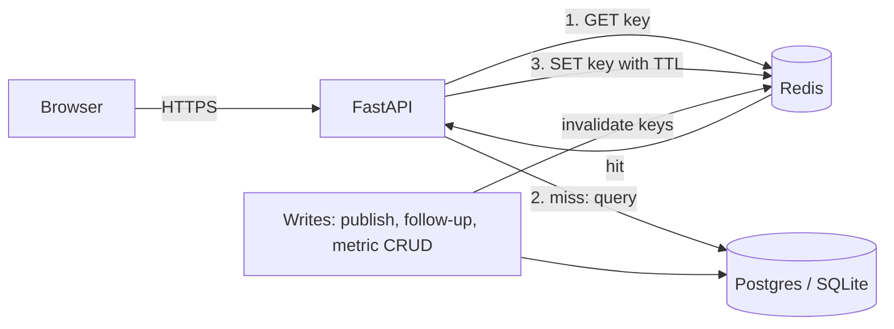

# Caching and performance

This guide covers how Pulseboard uses Redis, how each cache entry is kept correct, and which N+1 patterns were removed. Every claim here has a test in `tests/test_api.py`.

---

## 1. Where the cache sits



The pattern is **cache-aside**:
1. Read Redis.
2. On a miss, read the database.
3. Store the result with a TTL.

Writes always go to the database first, then delete the affected keys. The next read repopulates them.

Redis is **never the source of truth**. Losing it costs speed, not data.

---

## 2. Backends (`PB_CACHE_BACKEND`)

| Value | Used in | Behaviour |
|---|---|---|
| `redis` | Docker (`redis:7`), CI, Azure with `-DeployRedis` | Shared by every worker and instance, so invalidation is seen everywhere. Needs `PB_REDIS_URL`. |
| `memory` | Local `uvicorn`, tests | An in-process fake Redis with the same API. Only correct for **one** process. |
| `none` | Azure default (no Redis cost) | Every read goes to the database. Correct with any number of workers. |

**Why not `memory` in Azure:** gunicorn runs two workers. If worker A invalidates its own memory, worker B still holds stale data until its TTL expires. `none` is the safe default there.

If Redis becomes unreachable, every helper in `app/services/cache.py` logs a warning and returns a miss, so requests still succeed from the database. `/readyz` reports `"cache": "up" | "down" | "off"` without failing readiness.

---

## 3. Every key

All key names are defined in one module, `app/services/keys.py`, so writers and invalidators can't drift apart.

| Key | Holds | TTL | Written by | Invalidated by |
|---|---|---|---|---|
| `catalog:v1` | Enabled metrics, keyed by metric key | 5 min | `catalog.load_catalog` | metric create, update or delete |
| `metrics:list:<q>\|<area>\|<enabled>\|<page>\|<size>\|<sort>\|<desc>` | One page of catalog search | 60 s | `catalog.search` | any metric write (whole prefix) |
| `board:<board_id>` | A board (never while `BUILDING`) | 5 min | `GET /boards/{id}` and every ownership check | publish (whole family), release |
| `tiles:<board_id>` | A board's tiles in position order | 5 min | `GET /boards/{id}/tiles` | publish (whole family), follow-up change |
| `tile:<tile_id>:<YYYYMMDDHH>` | One tile's query result | 5 min | `GET /boards/{id}/tile-data`, `GET /tiles/{id}/data` | any metric write (whole prefix); rolls over each hour |
| `boards:<user>:<q>\|<kind>\|<page>\|<size>` | One page of "My boards" | 60 s | `GET /boards` | publish for that user (whole prefix) |

**Not cached, on purpose:**
- `GET /boards/overview`: it's polled while a board is `BUILDING`.
- `GET /jobs`: it changes constantly.
- Anything during the setup chat.

### Correctness rules
1. **Ownership is checked on every read, including cached ones.** `board:<id>` stores `user_id`, and the API compares it with the caller before returning anything.
2. **Transient state is never cached.** A `BUILDING` board is not written to Redis.
3. **Invalidate after the database commit.** If the commit fails, the cache still matches the database.
4. **Invalidate the whole board family on publish.** That covers the overview, every detail and briefing board, and boards the plan removed.

---

## 4. N+1 problems found and fixed

| # | Where | Before | After |
|---|---|---|---|
| 1 | Board page loading tile data | The browser sent **one HTTP request per tile**. Each request did 2 SQL lookups, a catalog load and a cache read. | `GET /boards/{id}/tile-data` returns every tile in **one request**: 1 SQL query for the tiles, 1 Redis `MGET`, 1 pipelined `SET` for misses, and 1 cached catalog load. |
| 2 | Tile ownership (`_owned_tile`) | Load the tile, then load its board: 2 queries | **One joined query**: `tiles JOIN boards WHERE tile.id = ? AND board.user_id = ?` |
| 3 | "My boards" tile and alert counts | Would need 1 count query per board | **One `GROUP BY`** with `SUM(CASE WHEN tier = 'ALERT')` |
| 4 | Scheduler enqueueing due boards | 1 SQS call per board | `send_message_batch`, **10 messages per call**. Azure Storage Queues have no batch API, so they send over one pooled connection. |
| 5 | Publishing a layout | n/a | Already bulk: one `DELETE` for old tiles, one `DELETE` for removed boards, inserts flushed together in one transaction |
| 6 | Reviewer reading follow-ups | n/a | Already one query for all tiles |

### Proof: `test_board_tile_data_is_batched_cached_and_constant_queries`
The test counts SQL statements while calling the batch endpoint on a board with many tiles:
- **Cold** (empty cache): at most **3 statements** in total, whatever the tile count.
- **Warm** (Redis populated): at most **1 statement** (the tile list). Ownership and every result come from Redis.

If anyone reintroduces a per-tile query, this test fails.

---

## 5. Measuring it yourself

```bash
# Docker stack running (docker compose up -d)
docker compose exec redis redis-cli --scan | cut -d: -f1 | sort | uniq -c   # keys by type
docker compose exec redis redis-cli monitor                               # watch GET/MGET/SET live
```
Responses also say where they came from. `GET /api/v1/metrics` returns `"cached": true|false`, and each item from `/tile-data` carries its own `cached` flag. The metric catalog page shows "cached" in its footer.

---

## 6. Tuning

| Setting | Default | Notes |
|---|---|---|
| `PB_CACHE_TTL_SECONDS` | 300 | Default TTL. List pages use 60 s. |
| Redis `maxmemory-policy` | `allkeys-lru` (Docker), `AllKeysLRU` (Azure) | When memory is full, the least-recently-used keys go first. |
| Redis `maxmemory` | 128 MB (Docker) | Much more than this app needs. |
