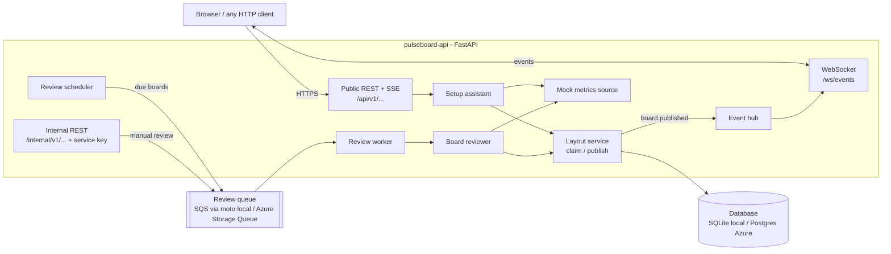
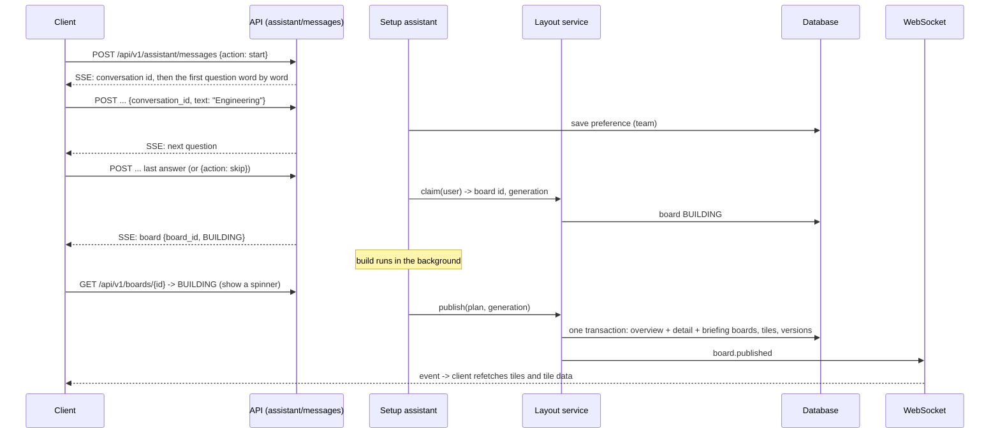
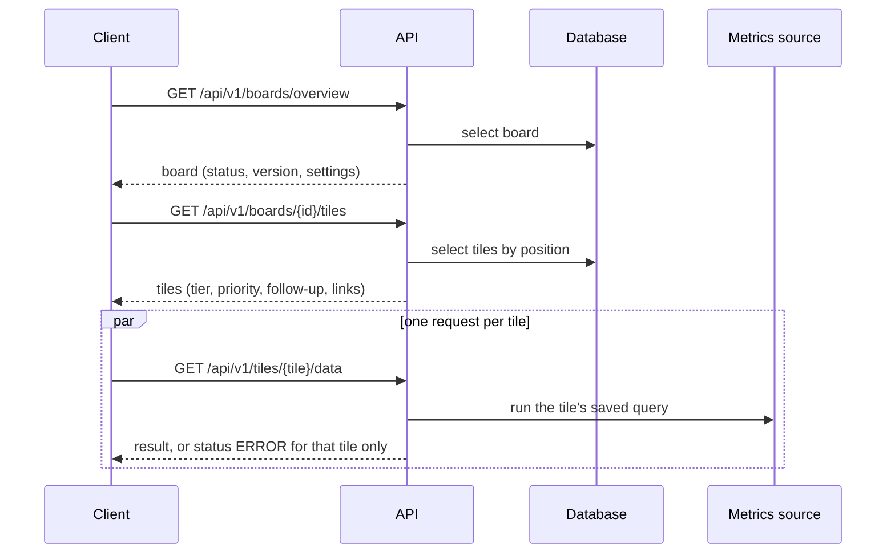
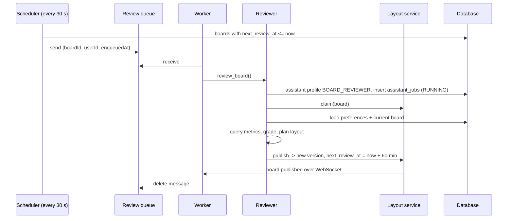
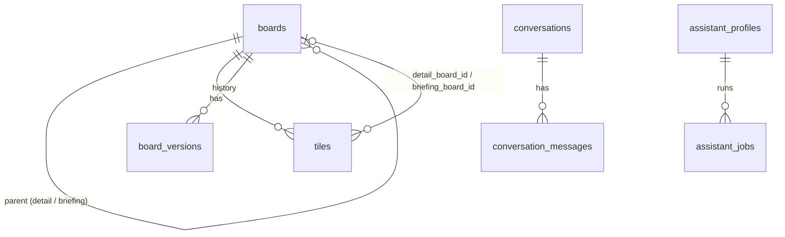

# Pulseboard: the project from end to end

This guide explains what Pulseboard is, how a request moves through it, how the code is organised, and how to run it on your laptop and on Azure. It ends with real output from a run.

---

## 1. What Pulseboard does

Pulseboard builds each user a personal **board** of business metrics, and an assistant keeps it up to date.

1. **Setup.** A new user chats with the **setup assistant**. It asks three questions:
   - which team they are on
   - which areas to watch (sales, customers, operations, engineering, finance)
   - which region (NA, EMEA, APAC, LATAM or all)
2. **Build.** The assistant turns the answers into a **board** of **tiles**. Each tile is one metric shown as a number, a trend line or a breakdown by region.
3. **Alerts.** A metric that has moved the wrong way becomes an **alert** tile with a priority (`MEDIUM` or `HIGH`). Each alert links to two more boards:
   - a **detail** board: 12-week trend, split by region, and a 4-week projection
   - a **briefing** board: a summary, who owns the metric, where the data comes from, and suggested next steps
4. **Follow-up.** The user marks an alert as `SEEN` or `DONE`.
5. **Review.** Every hour a background **reviewer** re-checks each board and publishes a fresh version. It keeps the user's follow-up marks.
6. **Live updates.** When a board changes, the API pushes an event over a **WebSocket**, so an open screen refreshes itself.

The metric numbers come from a **mock metrics source** with realistic, deterministic data. A real warehouse or semantic layer would replace it behind the same interface.

---

## 2. Architecture



| Piece | Local laptop | Azure |
|---|---|---|
| API runtime | `uvicorn` | App Service Linux B1, `gunicorn` + uvicorn workers |
| Database | SQLite file `pulseboard.db` | PostgreSQL Flexible Server B1ms |
| Review queue | **AWS SQS, mocked by a moto server** on `localhost:5000` | Azure Storage Queue (managed identity) |
| Secrets | `.env` file | Key Vault, read through Key Vault references |
| Logs and telemetry | console | Application Insights + Log Analytics |
| Live updates across servers | single process | Postgres `LISTEN/NOTIFY` relay |

---

## 3. The three main flows

### 3.1 Setup: from chat to board



- **SSE (Server-Sent Events)** streams the assistant's reply word by word over a normal HTTP response.
- Each answer is stored in `user_preferences`, so the reviewer can use it later.
- If the user **skips**, they get a default board (sales, customers, operations) with `origin_cd = DEFAULT_TEMPLATE`.

### 3.2 Reading a board



A failing metric query affects only its own tile. The response still returns HTTP 200 with `status: "ERROR"`, so the rest of the board loads.

### 3.3 Scheduled review



- If a review fails, the message stays on the queue and is retried.
- A message that fails more than 5 times is dropped and logged, so one bad message can't block the queue.

---

## 4. Safe publishing: claim and generation

Two jobs might try to rebuild the same board at once, for example the hourly review and a manual one. Without protection, the slower job could overwrite newer work. Pulseboard prevents that:

1. **`claim`** puts the job's name in `claim_holder`, sets an expiry (120 s), and **increments `generation`**. While the claim is live, another job's claim gets `409 Conflict`.
2. **`publish`** must present the same `claim_holder` **and** the same `generation`. If either changed, it gets `409`. This is a *fencing token*, and it stops a slow or abandoned job from writing stale data.
3. A publish writes **every board in the family in one database transaction**. Boards and tiles are matched by `slot_key` (for example `alert:sales.bookings`), so the same alert keeps the same detail and briefing boards over time.
4. Each publish adds a row to `board_versions` with a JSON snapshot, which gives a full history.
5. If a job crashes, `release` drops its claim and the previous version stays visible.

---

## 5. Data model



| Table | Purpose | Key columns |
|---|---|---|
| `boards` | Overview, detail and briefing boards | `kind_cd`, `slot_key`, `build_status_cd` (BUILDING/LIVE/FAILED), `version`, `claim_holder`, `generation`, `next_review_at`, `settings` (JSON) |
| `tiles` | One metric visual on a board | `position`, `visual_cd` (STAT/TREND/BREAKDOWN), `tier_cd` (ALERT/HEADLINE/CONTEXT), `priority_cd`, `follow_up_cd`, `query_spec` (JSON) |
| `board_versions` | Snapshot per publish | `board_id`, `version`, `job_id`, `snapshot` |
| `user_preferences` | What the assistant learned | `scope_cd` (LAYOUT/WATCHLIST), `key`, `value` |
| `assistant_profiles` | Registry of assistants | `key` (SETUP_ASSISTANT, BOARD_REVIEWER), model, tools |
| `assistant_jobs` | Every setup or review run | `job_type_cd`, `status_cd` (RUNNING/SUCCEEDED/FAILED/SKIPPED), timings |
| `conversations`, `conversation_messages` | Setup chat history | `state.step`, author, content |

Alembic migrations in `migrations/versions/` own the schema, and Azure runs `alembic upgrade head` on every start. Locally, tables are auto-created for convenience.

---

## 6. API reference

### Public (the user's JWT goes in `Authorization: Bearer …`)

| Method | Path | What it does |
|---|---|---|
| POST | `/api/v1/auth/dev-token` | Demo sign-in. Returns a JWT for any user id. Turn off with `PB_ENABLE_DEV_TOKEN=false`. |
| POST | `/api/v1/assistant/messages` | One setup turn, streamed as `text/event-stream`. Body: `{conversation_id?, action: start\|reply\|skip, text}` |
| GET | `/api/v1/boards/overview` | The caller's overview board (404 before setup) |
| GET | `/api/v1/boards/{id}` | Any board the caller owns |
| GET | `/api/v1/boards/{id}/tiles` | Tiles in position order |
| GET | `/api/v1/tiles/{id}/data` | Runs the tile's query: `{status: OK\|ERROR, result, error}` |
| PATCH | `/api/v1/tiles/{id}/follow-up` | `{follow_up_cd: SEEN\|DONE\|PENDING\|NONE}` |
| WS | `/ws/events?token=…` | Pushes `board.building` and `board.published` events |

SSE events from `/assistant/messages`: `conversation`, `delta` (text chunks), `board` (when building starts), `turn.end`, `error`.

### Internal (header `X-Service-Key`)

| Method | Path | What it does |
|---|---|---|
| GET | `/internal/v1/assistant-profiles/{key}` | Look up an assistant profile |
| POST / GET | `/internal/v1/preferences` | Save or load user preferences |
| POST | `/internal/v1/layouts/claim` | Claim a board, returns `generation` |
| POST | `/internal/v1/layouts/{id}/publish` | Publish a full layout plan |
| POST | `/internal/v1/reviews/{id}` | Put a review on the queue |
| POST | `/internal/v1/reviews/{id}/run` | Run a review now, skipping the queue |
| GET | `/internal/v1/jobs` | Recent setup and review jobs |

### Operations
`/healthz` checks the process is alive. `/readyz` also checks the database. `/docs` serves Swagger UI and is turned off in production.

Every error uses the same shape:
```json
{"error": {"code": "NOT_FOUND", "message": "Board not found", "details": {}, "request_id": "…"}}
```

---

## 7. Code tour

```
pulseboard-api/
├── app/
│   ├── main.py              App factory: middleware (request id, security headers, CORS, gzip),
│   │                        lifespan (DB, seed, background tasks), App Insights hook
│   ├── core/
│   │   ├── config.py        All settings (PB_* env vars); refuses default secrets in production
│   │   ├── logging.py       JSON logs with request ids
│   │   ├── errors.py        AppError types + one error response shape
│   │   └── security.py      JWT issue / verify, current user dependency
│   ├── db/
│   │   ├── models.py        The 8 tables
│   │   ├── session.py       Async engine (SQLite pragmas / Postgres pool)
│   │   └── seed.py          Assistant profiles
│   ├── schemas.py           Pydantic request/response models and the LayoutPlan contract
│   ├── api/
│   │   ├── public.py        Browser-facing endpoints
│   │   ├── internal.py      Service endpoints (constant-time key check)
│   │   ├── realtime.py      WebSocket
│   │   └── health.py
│   ├── assistants/
│   │   ├── setup.py         The 3-question conversation, SSE streaming, background build
│   │   ├── planner.py       Watchlist -> LayoutPlan (alerts first, detail + briefing per alert)
│   │   └── reviewer.py      The scheduled review job
│   └── services/
│       ├── layout.py        claim / publish / release (section 4)
│       ├── metrics.py       Mock metrics: catalog, query, projection, grading
│       ├── preferences.py   Save / load preferences
│       ├── queue.py         SQS (moto) and Azure Storage Queue adapters
│       ├── workers.py       Review scheduler + worker (backoff, poison messages)
│       └── events.py        WebSocket hub + Postgres LISTEN/NOTIFY relay
├── migrations/              Alembic (0001_initial_schema)
├── tests/test_api.py        12 tests covering every flow
├── infra/main.bicep         Azure infrastructure
├── scripts/
│   ├── dev.ps1              Start moto + API locally
│   ├── demo.py              End-to-end walkthrough (output in section 10)
│   └── azure-deploy.ps1     One-command Azure deploy
├── startup.sh               App Service start: migrate, then gunicorn
├── requirements.txt         What App Service installs
└── .github/workflows/       ci.yml (lint + tests), deploy.yml (to App Service)
```

**Swapping in a real AI model:** the assistants are deterministic rules today. A real model would replace `planner.build_plan` and the question flow in `setup.py`. Everything else stays the same, because the model would only produce a `LayoutPlan`, and the layout service already validates it and publishes it safely.

---

## 8. Production practices built in

| Area | What's done |
|---|---|
| **Correctness** | Fencing tokens on publish. One transaction per publish. Follow-ups preserved across reviews. Idempotent queue handling with poison-message cutoff. |
| **Security** | JWT auth. Users can only read their own boards (others get 404, so existence isn't revealed). Constant-time service-key check. Production refuses default secrets. Security headers on every response. Strict CORS list. Secrets in Key Vault, read with managed identity. Storage shared keys disabled. HTTPS only, TLS 1.2. |
| **Resilience** | Workers back off when the queue is down instead of crashing. One tile's failure doesn't break the board. WebSocket keep-alive pings. DB pool pre-ping and recycle. |
| **Observability** | JSON logs with a request id (also returned as `X-Request-ID`). Application Insights traces. 5xx alert. Budget alert. |
| **Operability** | `/healthz` and `/readyz`. Alembic migrations on startup. CI runs lint and tests. CD deploys only after CI passes. One-command infrastructure. |
| **Scale-out ready** | Stateless API. Postgres relay for WebSocket events. `SKIP LOCKED` in the scheduler. Claims stop duplicate reviews. |

---

## 9. Running it

### Locally (mock AWS)
```powershell
cd pulseboard-api
python -m venv .venv
.\.venv\Scripts\python -m pip install -e ".[dev]"
copy .env.example .env
.\.venv\Scripts\python -m moto.server -p 5000                         # terminal 1: mock AWS SQS
.\.venv\Scripts\python -m uvicorn app.main:app --reload --port 8000   # terminal 2: API
.\.venv\Scripts\python scripts\demo.py                                # terminal 3: walkthrough
```
Swagger UI: http://localhost:8000/docs

### Tests
```powershell
.\.venv\Scripts\python -m pytest -q        # 12 passed
.\.venv\Scripts\python -m ruff check .     # All checks passed!
```

### Azure
```powershell
az login --tenant <your-tenant-id>
./scripts/azure-deploy.ps1 -OwnerEmail you@example.com     # infra + code + smoke test
./scripts/azure-deploy.ps1 -OwnerEmail you@example.com -SkipInfra   # code only
az group delete -n rg-pulseboard                           # remove everything
```

Resources and approximate cost on a free trial:

| Resource | Tier | Cost |
|---|---|---|
| App Service | Linux B1 | about ₹35/day |
| PostgreSQL Flexible | B1ms, 32 GB | free (750 h/month on a free account) |
| Storage Queue | Standard LRS | about ₹0 |
| Key Vault | Standard | about ₹0 |
| App Insights + Log Analytics | 0.15 GB/day cap | free tier |
| Budget + 5xx alert | | free |

Region: **Central India**. This subscription is blocked from creating Postgres in South India and East US.

---

## 10. Real output: local run

This is `python scripts/demo.py` against the local API, with SQLite and mock AWS SQS:

```text
=== Health  (http://localhost:8000) =======================================
  /healthz -> {'status': 'ok'}
  /readyz  -> {'status': 'ok', 'database': 'up'}

=== Sign in as demo-74974 =================================================
  got JWT (eyJhbGciOiJIUzI1NiIsInR5...)
  overview before setup -> HTTP 404 (NOT_FOUND)

=== Setup assistant (streamed over SSE) ===================================
  assistant > Hi! I'll set up your overview board. Three quick questions. Which team are you on? For example Sales, Customer Success, Operations, Engineering or Finance.
  you       > Engineering
  assistant > Thanks. Which areas should I watch for you? Pick any of sales, customers, operations, engineering, finance.
  you       > sales, customers, operations, engineering and finance
  assistant > Thanks. Should I focus on one region (NA, EMEA, APAC, LATAM) or all of them?
  you       > EMEA please
  assistant > Great, that's all I need. Building your board now.
  board 5f490f1a-d5f9-4465-b735-2f8be97ac656 -> BUILDING

=== Wait for the board to go live =========================================
  build_status=BUILDING version=0
  build_status=BUILDING version=0
  build_status=BUILDING version=0
  build_status=LIVE version=1
  team='Engineering' areas=['sales', 'customers', 'operations', 'engineering', 'finance'] region=EMEA alerts=3

=== Tiles on the overview (each tile's data fetched separately) ===========
   1. [ALERT    HIGH  ] Open support tickets             103 tickets (+9.3% vs avg)
   2. [ALERT    MEDIUM] Net promoter score               37.561 pts (-5.9% vs avg)
   3. [ALERT    MEDIUM] New bookings                     262,896.428 USD (-5.6% vs avg)
   4. [HEADLINE LOW   ] Pipeline coverage                3.219 x (+3.8% vs avg)
   5. [HEADLINE LOW   ] Logo churn                       1.73 % (-3.1% vs avg)
   6. [HEADLINE LOW   ] Order-to-delivery time           4.343 days (-2.8% vs avg)
   7. [HEADLINE LOW   ] Service availability             96.133 % (-2.0% vs avg)
   8. [HEADLINE LOW   ] Change failure rate              9.874 % (-9.0% vs avg)
   9. [HEADLINE LOW   ] Cloud spend                      54,255.295 USD (+2.5% vs avg)
  10. [CONTEXT  LOW   ] New bookings trend               12 points, last 262,896.428 USD
  11. [CONTEXT  LOW   ] Pipeline coverage trend          12 points, last 3.219 x

=== Alert drill-through: Open support tickets =============================
  detail: Open support tickets: detail
     - Last 12 weeks                12 points, last 103 tickets
     - By region                    NA=53, EMEA=103, APAC=87, LATAM=75
     - Next 4 weeks (projected)     16 points, last 101 tickets (4 projected)
  briefing: Open support tickets: briefing
     - Now vs baseline              103 tickets (+9.3% vs avg)
     - Outlook                      16 points, last 101 tickets (4 projected)
     summary:    Open support tickets is up 9.3% against its recent average.
     owners:     Support
     next step:  Raise it at the next Engineering sync.
     next step:  Check recent drivers with Support.
     next step:  Confirm the data in helpdesk.tickets is complete before acting.
  marked alert follow-up -> SEEN

=== Scheduled review through the queue ====================================
  enqueue -> {'queued': True, 'message_id': 'eda8a283-ff36-4f40-af73-97dc11081abc'}
  board version now 2 (next review at 2026-10-16T19:23:04.381651)
  alert follow-up after review -> SEEN
  job REVIEW SUCCEEDED
  job SETUP  SUCCEEDED

=== Done ==================================================================
```

**How to read it:**
- **404 before setup:** the user has no board yet. A client would send them to the setup chat.
- **BUILDING → LIVE:** the board is built in the background, and a UI would show a spinner during that time.
- **Alerts first:** the support backlog is up 9.3% where lower is better, so it is HIGH. NPS and bookings are down more than 3% where higher is better, so they are MEDIUM. "Change failure rate −9%" is *good*, because lower is better, so it is not an alert.
- **Drill-through:** the alert opens its detail board (trend, regions, projection) and its briefing board (summary, owner, next steps).
- **Review via the queue:** the message went through mock AWS SQS, the worker ran the reviewer, the board moved to **version 2**, and the user's `SEEN` mark **survived**.

---

## 11. Known limits and next steps

- **Sign-in is demo-only** (`/auth/dev-token`). Next: Microsoft Entra ID (OIDC), then set `PB_ENABLE_DEV_TOKEN=false`.
- **Postgres is reachable from any Azure service** through its firewall rule. Next: VNet integration with private access.
- **No API gateway or autoscale on B1**, to keep costs low. Next: move to S1/P0v3 and add API Management when there is traffic.
- **The assistants are rules, not an AI model**, and the metrics are mocked. Section 7 explains how to swap in real ones.
- **The frontend is not built yet.** It is planned as an Angular monorepo.

## 12. Version 2: catalog CRUD, cache, navigation, Docker

### Metric catalog in the database (nothing hardcoded)
| Before | Now |
|---|---|
| Metrics hardcoded in `metrics.py` | `metrics` table (migration `0002`), seeded once from `app/db/seed_metrics.py`, then managed in the UI |
| Setup questions listed fixed areas and regions | Areas come from the catalog; regions, units and page sizes come from settings (`PB_REGIONS`, `PB_UNITS`, `PB_PAGE_SIZES`) |
| Area matching used a fixed word list | Matches catalog area names and metric-title words |
| UI had fixed units, page sizes and API URLs | UI reads `/api/v1/meta` and loads runtime `/config.json` |

### New API
| Method | Path | Notes |
|---|---|---|
| GET | `/api/v1/meta` | regions, units, areas, page sizes, enums used for menus |
| GET | `/api/v1/metrics?q&area&enabled&sort&desc&page&size` | search and paginate; `cached: true` when served by Redis |
| GET / POST / PUT / DELETE | `/api/v1/metrics[/{key}]` | full CRUD; 409 on duplicate key, 422 on bad unit or format |
| GET | `/api/v1/metrics/areas` | distinct areas |
| GET | `/api/v1/boards?q&kind&page&size` | the user's boards with tile and alert counts |
| GET | `/api/v1/jobs?job_type&status&page&size` | the user's setup and review history |

### Redis cache
| Key | TTL | Invalidated by |
|---|---|---|
| `catalog:v1` | 5 min | any metric create, update or delete |
| `metrics:list:<query>` | 60 s | any metric write |
| `tile:<id>:<hour>` | 5 min | metric write (results also roll over hourly) |
| `boards:<user>:<query>` | 60 s | a publish for that user |

- `PB_REDIS_URL` set: a real Redis (Docker `redis:7`, or Azure Managed Redis).
- `PB_REDIS_URL` unset: an in-process fake Redis with the same API, so no server is needed.
- Every cache error falls back to the database. `/readyz` reports `cache: up|down` without failing.

### Frontend navigation
The sidebar has **Overview · My boards · Metric catalog · Activity · Setup assistant**.
- The active link is highlighted, and the sidebar collapses to a top bar on phones.
- The footer shows WebSocket status, the signed-in user, and sign-out.
- Toasts confirm saves and deletes, show errors, and announce `board.published` events.
- Every list uses the shared pager, with page sizes taken from `/meta`.

### Realtime
- **SSE:** setup-assistant turns stream word by word.
- **WebSocket `/ws/events`:** carries `board.building` and `board.published`. Board pages refetch, Activity refreshes, and a toast appears. It reconnects with backoff, and sends a ping every 25 s.
- **Postgres `LISTEN/NOTIFY`:** relays events between API instances.

### Docker
`pulseboard-api/docker-compose.yml` runs the whole stack:

| Service | Image | Port |
|---|---|---|
| postgres | postgres:16-alpine | 5432 |
| redis | redis:7-alpine (LRU, 128 MB) | 6379 |
| sqs (mock AWS) | motoserver/moto | 5000 |
| api | `pulseboard-api/Dockerfile` (multi-stage, non-root, healthcheck, Alembic on start) | 8000 |
| web | `pulseboard-web/Dockerfile` (Node build → unprivileged nginx, SPA fallback, `config.json` written from `API_URL`/`WS_URL`) | 8080 |

```bash
cd pulseboard-api && docker compose up --build
# UI  http://localhost:8080   API docs http://localhost:8000/docs
```
